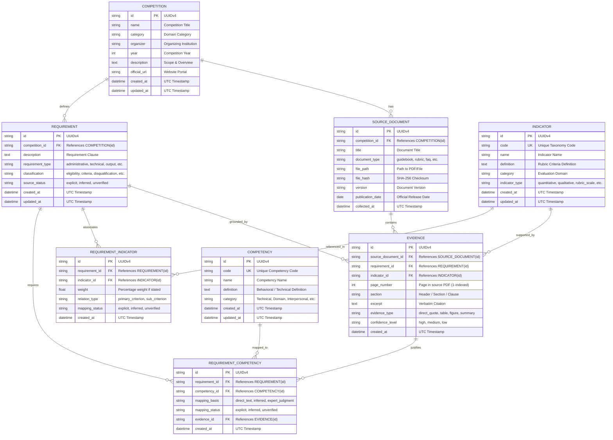

# Database Design — AI Competition Mentor (V0.1)

## 1. Entity-Relationship Diagram

## 2. Table Specifications & Constraints

### 2.1 `competitions`
* Primary Key: `id` (VARCHAR(36))
* Indexes: `name`, `category`, `organizer`, `year`

### 2.2 `source_documents`
* Primary Key: `id` (VARCHAR(36))
* Foreign Key: `competition_id` REFERENCES `competitions(id)` ON DELETE CASCADE
* Integrity: `file_hash` stores SHA-256 for physical file verification.

### 2.3 `requirements`
* Primary Key: `id` (VARCHAR(36))
* Foreign Key: `competition_id` REFERENCES `competitions(id)` ON DELETE CASCADE
* Indexes: `source_status` (`explicit`, `inferred`, `unverified`)

### 2.4 `indicators`
* Primary Key: `id` (VARCHAR(36))
* Unique Constraint: `code` (e.g., `IND_INNOVATION_TECH`)
* Indexes: `code`, `category`

### 2.5 `requirement_indicators`
* Primary Key: `id` (VARCHAR(36))
* Unique Constraint: `(requirement_id, indicator_id)`
* Foreign Keys: `requirement_id` ON DELETE CASCADE, `indicator_id` ON DELETE CASCADE

### 2.6 `evidences`
* Primary Key: `id` (VARCHAR(36))
* Check Constraint: `requirement_id IS NOT NULL OR indicator_id IS NOT NULL`
* Foreign Keys: `source_document_id` ON DELETE CASCADE, `requirement_id` ON DELETE CASCADE, `indicator_id` ON DELETE CASCADE

### 2.7 `competencies`
* Primary Key: `id` (VARCHAR(36))
* Unique Constraint: `code` (e.g., `COMP_SOFTWARE_ENG`)
* Indexes: `code`, `category`

### 2.8 `requirement_competencies`
* Primary Key: `id` (VARCHAR(36))
* Unique Constraint: `(requirement_id, competency_id)`
* Foreign Keys: `requirement_id` ON DELETE CASCADE, `competency_id` ON DELETE CASCADE, `evidence_id` ON DELETE SET NULL

